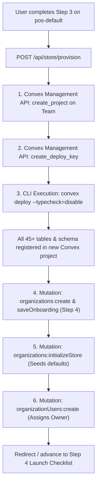

# PREST POS: Complete Store Onboarding Architecture & Test Suite Documentation

> **Document Type:** Specification, Architecture Breakdown & QA Test Guide  
> **Target Application:** `pos-default` (PREST POS Suite)  
> **Route:** `/onboarding` & Associated Store Setup Routes  
> **Backend:** Convex Database & Mutations + Serverless APIs  

---

## 1. Executive Summary & Flow Overview

The PREST onboarding system guides new restaurant owners from account creation to a fully configured, operational POS terminal across 4 structured steps:

```
[ Step 1: Organisation & Restaurant Identity ]
               │
               ▼
[ Step 2: Location & Regional Preferences ]
               │
               ▼
[ Step 3: Operations & Fulfillment Modalities ]
               │
               ▼
[ Step 4: Restaurant Launch Checklist (6 Prerequisites) ]
               │ (Must complete all 6 checklist items)
               ▼
[ Proceed to Dashboard Studio -> /dashboard ]
```

### Core Architecture Guardrails:
1. **Strict Dashboard Lockdown**: Users **CANNOT** access `/dashboard` until all 6 checklist tasks in Step 4 are 100% completed. Visiting `/dashboard` automatically redirects back to `/onboarding`.
2. **Setup Return Guard**: When a user clicks any checklist action (e.g., adding menu items, configuring taxes, setting up tables), the POS shell displays a persistent `"← Back to Onboarding Checklist"` navigation button and remaps dashboard links to `/onboarding`.
3. **Step 4 Manual Checklist Independence**: Tasks in the Step 4 Checklist remain unchecked until the user performs the setup action or explicitly ticks the item, preventing empty or unconfigured stores from having auto-marked steps.
4. **Self-Sustaining Multi-Store Provisioning**: When Step 3 completes, `/api/store/provision` autonomously provisions a dedicated Convex project, runs `convex deploy` to deploy all 45+ tables and functions, and seeds store defaults without requiring `pos-master`.

---

## 2. Multi-Store Architecture: pos-default Self-Sustaining Model vs pos-master Flow

### High-Level Architecture Comparison:

| Feature / Capability | Legacy Master Flow (`pos-master`) | Modern Self-Sustaining Flow (`pos-default`) |
| :--- | :--- | :--- |
| **User Sign-up Entry** | Users signed up in `pos-master` | Users sign up directly in `pos-default` (`/sign-up`) |
| **Store Creation Trigger** | Store created inside `pos-master` dashboard | Triggered upon completing **Step 3** in `/onboarding` |
| **Convex Backend Creation** | Management API called from `pos-master` | Management API called directly from `pos-default` (`/api/store/provision`) |
| **Schema & Tables Setup** | `pos-master` ran `convex deploy` via GitHub Actions/runner | `pos-default` runs `convex deploy` using the generated `deployKey` |
| **Default Data Seeding** | `organizations:initializeStore` called by runner | `organizations:initializeStore` called directly upon project deploy |
| **Post-Creation Experience** | User redirected to store POS URL | User seamlessly transitions to **Step 4 Launch Checklist** |
| **Master POS Compatibility** | Fully supported (bridge resolver intact) | Fully backward-compatible; existing master bridge remains active |

### Provisioning Lifecycle (`/api/store/provision`):



---

## 3. Comprehensive Step-by-Step Breakdown

### Step 1: Organisation & Restaurant Identity

#### Description & Purpose:
Captures the legal entity name, brand name, business classification, and single vs. multi-unit store architecture.

#### Key Form Fields & Options:
1. **Legal Organisation Name**: `orgName` (e.g., `"Prest Hospitality Group LLC"`).
2. **Restaurant / Store Front Name**: `restName` (e.g., `"Shree Marutinandan Kathiyawadi Restaurant"`).
3. **Business Classification (`businessType`)**:
   - `fsg`: Full-Service Restaurant (Dine-in / Bar)
   - `qsr`: Quick Service (Counter / Fast)
   - `fc`: Fast Casual (Hybrid Flow)
   - `cafe`: Cafe & Coffee Shop (Roastery / Tea)
   - `bakery`: Bakery & Dessert Shop (Artisan Baked)
   - `bar`: Bar & Pub (Nightlife / Tap)
   - `truck`: Food Truck (Mobile POS)
   - `ghost`: Ghost Kitchen (Delivery Only)
   - `other`: Other (Custom Setup)
4. **Location Scale (`locationsCount`)**:
   - `one`: Single Location
   - `multiple`: Multi-unit / Chain Brand

#### Real-Time Google Places Integration:
- **Autocomplete**: As the user types their restaurant name (>= 2 chars), debounced requests (300ms) call `/api/places/autocomplete`.
- **Auto-Detection**: Selecting a place triggers `/api/places/details`, pre-populating:
  - Street address, city, state, postal code, country
  - Direct telephone number
  - Currency & time zone
  - Business type auto-detection (e.g., if Google types include `"cafe"`, auto-selects `cafe`; if `"bakery"`, auto-selects `bakery`).
- **Manual Override**: Option to click `"Enter address manually"` to bypass Google Places.

#### Validations:
- `legalEntityName` / `orgName`: Required, non-empty, trimmed string.
- `restaurantName` / `restName`: Required, non-empty, trimmed string.
- Immediate inline error displays if attempting to submit blank values.

#### Database Persistence:
- Calls `api.organizations.saveOnboarding` with:
  ```ts
  {
    id: activeOrg._id,
    step: 2,
    organizationName: orgName.trim(),
    restaurantName: restName.trim(),
    businessType,
    locationsCount
  }
  ```

---

### Step 2: Location Information & Regional Preferences

#### Description & Purpose:
Gathers precise physical restaurant address, currency, localization, telephone, and operational time zone.

#### Key Form Fields:
1. **Branch / Location Name**: `locationName` (defaults to `<Restaurant Name> — Main`).
2. **Country**: Standard 2-letter ISO code or name (`US`, `IN`, `GB`, `AE`, `CA`, etc.).
3. **Street Address**: `streetAddress` (Primary address line).
4. **Suite / Unit**: `suiteUnit` (Optional, apartment/suite number).
5. **City**: `city`.
6. **State / Province**: `state`.
7. **Postal / Zip Code**: `zipCode`.
8. **Direct Contact Phone**: `phoneNumber` (auto-formatted with country code fallback).
9. **Default Currency**: `currency` (e.g., `USD`, `INR`, `EUR`, `GBP`, `AED`).
10. **System Language**: `language` (e.g., `en-US`, `en-GB`, `fr-FR`).
11. **Time Zone**: `timezone` (e.g., `America/Los_Angeles`, `Asia/Kolkata`, `Europe/London`).

#### Validations:
- `country`: Required.
- `streetAddress`: Required.
- `city`: Required.
- `state`: Required.
- `zipCode`: Required.
- `currency`: Defaults to country-matched currency standard.

#### Database Persistence:
- Calls `api.organizations.saveOnboarding` with:
  ```ts
  {
    id: activeOrg._id,
    step: 3,
    restaurantName: locationName.trim() || restName.trim(),
    addressLine1: streetAddress.trim(),
    suiteUnit: suiteUnit.trim(),
    city: city.trim(),
    state: state.trim(),
    zipCode: zipCode.trim(),
    country: country.trim(),
    phone: phoneNumber.trim(),
    currency: currency.trim(),
    language: language.trim(),
    organizationTimeZone: timezone.trim()
  }
  ```

---

### Step 3: Operations & Fulfillment Modalities

#### Description & Purpose:
Configures POS operating modes (Dine-In, Takeaway, Delivery), fleet logistics, and operational trading hours.

#### Key Form Fields:
1. **Fulfillment Modes (At least one must be checked)**:
   - `isDineIn`: Enables table management, floor maps, and captain ordering.
   - `isPickup` (`isTakeAway`): Enables counter takeaway orders.
   - `isDelivery`: Enables delivery dispatch & driver assign.
2. **Delivery Fleet Type** (visible if `isDelivery` is true):
   - `inhouse`: Store drivers
   - `thirdparty`: Aggregator integrations (DoorDash, UberEats, Deliveroo)
   - `blended`: Hybrid dispatch model
3. **Operating Hours Template**:
   - `standard`: 11:00 AM – 10:00 PM every day (Mon–Sun).
   - `custom`: Split Weekday (Mon–Fri) vs Weekend (Sat–Sun) hours.
   - `later`: 11:00 AM – 11:59 PM placeholder (setup deferred).

#### Validations:
- **Service Mode Rule**: `(!isDineIn && !isPickup && !isDelivery)` is strictly rejected with toast: `"Please select at least one fulfillment modality"`.
- If custom hours selected: End time must be after start time without overlapping slots.

#### Database Persistence:
- Saves operational settings to Convex:
  ```ts
  await saveOnboardingMutation({
    id: activeOrg._id,
    step: 4,
    completed: false, // STAYS FALSE UNTIL CHECKLIST IS FINISHED!
    isDineIn,
    isTakeAway: isPickup,
    isDelivery,
    deliveryFleetType,
    operatingHoursTemplate: operatingHours,
    operationTiming: generatedOperationTiming,
  });
  ```
- Advances UI state directly to **Step 4: Launch Checklist**.

---

### Step 4: Restaurant Launch Checklist (The Final Gate)

#### Description & Purpose:
The final step inside `/onboarding` presenting the 6 operational setup tasks required before opening live service.

#### The 6 Checklist Items:
| # | Task Name | Badge | Action Button | Target Destination | Reactive Detection Query |
|---|-----------|-------|---------------|-------------------|--------------------------|
| 1 | **Add your menu** | `Essential` | Add Menu Items → | `/menu` | `api.menu.listMenus` (count > 0) |
| 2 | **Configure taxes** | `Jurisdiction` | Review Taxes → | `/settings?tab=organization&subTab=taxation` | Organization tax rate configured / manual |
| 3 | **Connect payment methods** | `Terminal Link` | Set Up Payments → | `/settings?tab=payment` | `api.paymentModes.listPaymentModes` |
| 4 | **Set up tables** | `Floor Map` | Floorplan Editor → | `/settings?tab=tables` | `api.organizationTables.list` |
| 5 | **Configure kitchen display** | `KDS Routing` | Route KDS → | `/kds` | `api.stations.list` |
| 6 | **Add employees** | `Permissions` | Invite Staff → | `/settings?tab=staff` | `api.organizationUsers.list` |

#### Progress & Gate Logic:
- **Completion Counter**: Tracks `doneCount` (0 of 6 to 6 of 6) and percentage circle (0% to 100%).
- **Manual Toggle**: Clicking the checkbox toggles an item complete or incomplete and syncs to `organization.onboardingChecklist` in Convex via `api.organizations.updateOnboardingChecklist`.
- **Dynamic Auto-Detection**: Real-time Convex database queries automatically tick off tasks when records are created.
- **Proceed Button Lockdown**:
  - If `doneCount < 6`: Button is disabled (`bg-[#e5e2e1]`, `cursor-not-allowed`, opacity 60%).
  - If `doneCount === 6`: Button becomes active (`bg-[#1f1f1f] text-white`).
  - Clicking active button calls `updateChecklistMutation({ id, markCompleted: true })`, setting `onboardingCompleted: true` and `onboardingCompletedAt: Date.now()`, then navigates to `/dashboard`.

---

## 3. Route Guarding & Shell Integration

### Dashboard Protection (`app/dashboard/page.tsx`):
```tsx
useEffect(() => {
  if (activeOrg && activeOrg.onboardingCompleted !== true) {
    router.replace("/onboarding");
  }
}, [activeOrg, router]);
```

### PosShell Navigation Adaptation (`app/components/PosShell.tsx`):
1. **Header Return Button**:
   When `activeOrg.onboardingCompleted !== true`, a button is displayed in the top header:
   ```tsx
   <Link href="/onboarding" className="inline-flex items-center gap-1.5 px-3 py-1 bg-[#1f1f1f] text-white text-xs font-medium rounded-lg">
     ← Back to Onboarding Checklist
   </Link>
   ```
2. **Sidebar Redirection**:
   The primary `Dashboard` navigation link dynamically targets `/onboarding` instead of `/dashboard` whenever onboarding is incomplete.

---

## 4. Database Schema Reference (`convex/schema.ts`)

```ts
organizations: defineTable({
  // ... other fields
  onboardingStep: v.optional(v.number()),              // Current active step (1, 2, 3, or 4)
  onboardingCompleted: v.optional(v.boolean()),         // true ONLY after 6/6 checklist items
  onboardingCompletedAt: v.optional(v.number()),       // Timestamp of completion
  onboardingDismissedBanner: v.optional(v.boolean()),  // Banner status
  onboardingChecklist: v.optional(v.array(v.number())),// Array of completed task IDs [1, 2, 3, 4, 5, 6]
})
```

---

## 5. Comprehensive QA Test Case Suite

Use this table to verify every aspect of the onboarding system.

| Test Case ID | Feature / Area | Pre-Conditions | Test Execution Steps | Expected Outcome | Pass/Fail |
|--------------|----------------|----------------|----------------------|------------------|-----------|
| **TC-ONB-01** | Step 1 Validation | On `/onboarding` (Step 1) | Leave Organisation & Restaurant name blank, click Continue. | Validation errors displayed under both inputs; cannot advance to Step 2. | [ ] |
| **TC-ONB-02** | Google Places Auto-fill | On `/onboarding` (Step 1) | Type a valid restaurant name (e.g. "Marutinandan") and select an autocomplete item. | Step 2 address, city, state, zip, phone, and business type auto-populate. | [ ] |
| **TC-ONB-03** | Step 2 Submission | Step 1 completed | Fill verified address details and submit Step 2. | Step 2 saves to Convex `onboardingStep: 3`; proceeds to Step 3. | [ ] |
| **TC-ONB-04** | Step 3 Service Mode Guard | Step 2 completed | Uncheck Dine-In, Pickup, and Delivery (all unchecked) and submit. | Toast alert: "Please select at least one fulfillment modality". Submission blocked. | [ ] |
| **TC-ONB-05** | Step 3 to Checklist Transition | Step 3 filled | Select at least one service mode and submit Step 3. | Convex updates `onboardingStep: 4` and keeps `onboardingCompleted: false`. Step 4 Checklist renders. | [ ] |
| **TC-ONB-06** | Dashboard Direct URL Lockdown | Onboarding incomplete (`onboardingCompleted: false`) | Manually enter `http://localhost:3000/dashboard` in browser URL bar. | Browser immediately redirects back to `http://localhost:3000/onboarding`. | [ ] |
| **TC-ONB-07** | Proceed Button Disabled (< 6 items) | On Step 4 Checklist | Ensure fewer than 6 items are completed (e.g. 3 of 6). | "Proceed to Dashboard Studio" button is disabled and unclickable. | [ ] |
| **TC-ONB-08** | Navigation Return from Setup | On Step 4 Checklist | Click "Add Menu Items" (routes to `/menu`). | Navigates to `/menu`. Top header shows "← Back to Onboarding Checklist". Clicking it returns to `/onboarding`. | [ ] |
| **TC-ONB-09** | Shell Sidebar Dashboard Link | On `/menu` during onboarding | Click "Dashboard" in left sidebar. | Navigates to `/onboarding` (not `/dashboard`). | [ ] |
| **TC-ONB-10** | Manual Item Toggle & Persistence | On Step 4 Checklist | Click checkbox on item 2 ("Configure taxes") to complete it. Refresh page. | Item 2 remains checked after reload (persisted in Convex `onboardingChecklist`). | [ ] |
| **TC-ONB-11** | Full Completion & Dashboard Unlock | On Step 4 Checklist | Complete all 6 tasks (6 of 6, 100%). | "Proceed to Dashboard Studio" button turns active black. Clicking it sets `onboardingCompleted: true` and loads `/dashboard`. | [ ] |
| **TC-ONB-12** | Post-Completion Access | Onboarding complete (`onboardingCompleted: true`) | Navigate to `/dashboard`. | Dashboard loads normally without being redirected to `/onboarding`. | [ ] |

---

## 6. How to Run Automated Unit & Integration Tests

Run the test suite in powershell or bash from the project root:

```bash
npx vitest run app/
```

### Verified Passing Suites:
- `app/api/orders/__tests__/route.test.ts`
- `app/api/webhooks/clerk/__tests__/route.test.ts`
- `app/api/store/provision/__tests__/route.test.ts`
- `app/api/places/details/__tests__/route.test.ts`
- `app/api/places/autocomplete/__tests__/route.test.ts`
- `app/api/auth/register-owner/__tests__/route.test.ts`
- `app/api/auth/phase5-hardening.test.ts`
- `app/components/kds/CreateStationDrawer.test.ts`
- `app/components/kds/UpdateStationDrawer.test.ts`
- `app/components/kds/KdsTerminalView.test.ts`
- `app/components/kds/AddItemsToStationDrawer.test.ts`
- `app/api/staff/create/route.test.ts`
- `app/api/marketplace/razorpay/razorpayRoutes.test.ts`

