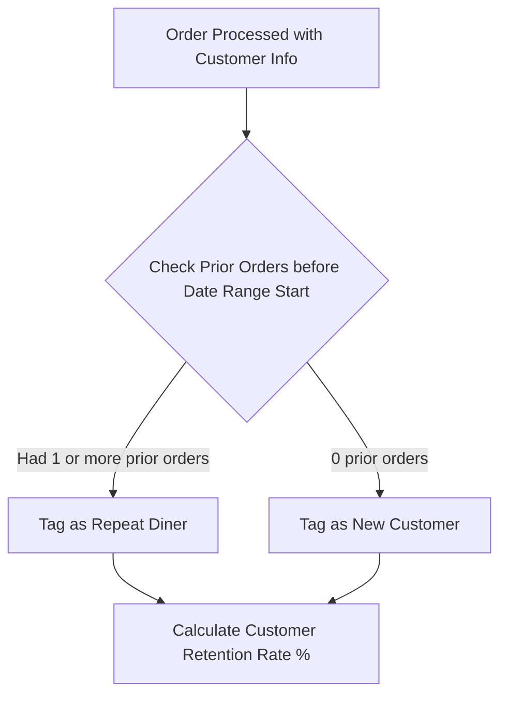

# POS Reports Implementation & Business Logic Specification

> **Scope**: Detailed calculation models, business rules, edge-case handling, and implementation specifics for the **Menu Report**, **Orders Report**, and **Customer Report** in `pos-default`.

---

## 1. Executive Summary & Design System Standards

All reporting modules in `pos-default` share a unified architecture, visual design language, and financial accounting foundation:

1. **Reactive Backend on Convex**:
   - Reports stream data via real-time subscriptions using Convex queries (`convex/reports.ts`, `convex/inventory.ts`).
   - Range filtering uses Unix epoch millisecond timestamps (`fromTimestamp`, `toTimestamp`) indexed on `["organizationId", "createdAt"]`.
2. **Internationalization & Regional Settings**:
   - All currencies, timezones, and date formats are centralized through `lib/constants/countries.ts` (`formatPriceWithSymbol`, `formatStoreDate`, `formatStoreTime`, `getCurrencyForCountry`, `getTimezoneForCountry`).
   - Currency is stored as integer minor units (paise/cents) to eliminate floating-point precision issues.
3. **Cancellation & Payment Gating**:
   - Cancelled or rejected orders (`order.isRejected`, `order.orderStatus === "Cancelled"`, or `order.status === "Cancelled"`) are strictly excluded from all revenue, velocity, and AOV calculations.
4. **Visual & UI Typography Consistency**:
   - **Page Titles**: Classical serif header font (`EB Garamond`, `text-[32px] md:text-[36px] font-normal`).
   - **Date Range Picker**: Standardized `OrderDateRangePicker` across all reports with presets (`Today`, `Yesterday`, `Last 7 Days`, `Last 30 Days`, `This Month`, `Custom Range`).
   - **Table Density**: Clean row padding (`py-3 px-3.5`), readable typography (`text-xs font-medium`), tabular numbers (`tabular-nums`), and pill status badges.
   - **Export Engine**: Instant browser-side CSV generation with sanitized values and proper currency labels.

---

## 2. Menu Report (`MenuReportView.tsx` & `convex/inventory.ts`)

The **Menu Report** provides granular Product Mix (PMIX), item velocity, category contribution, and theoretical food costing analytics.

### 2.1 Core Metrics & Mathematical Formulas

| Metric | Formula | Description |
| :--- | :--- | :--- |
| **Units Sold (Qty)** | $\sum \text{item.quantity}$ | Total quantity of this menu item ordered across non-cancelled orders. |
| **Unit Price** | $\text{itemPricePaise}$ | Base catalog unit price or line item unit rate. |
| **Line Subtotal** | $\text{item.quantity} \times \text{unitPrice}$ | Base sales volume of the item before taxes and customizations. |
| **Rev Share %** | $\left( \frac{\text{Item Gross Sales}}{\text{Total All Items Gross Sales}} \right) \times 100$ | Proportion of total catalog sales revenue generated by this single item. All items sum to 100%. |
| **Theoretical Recipe Cost** | $\sum_{\text{BOM}} (\text{Portion Qty} \times \text{Ingredient Unit Cost})$ | Cost of all bill-of-materials (BOM) ingredients configured for this item in Inventory. |
| **Theoretical Food Cost %** | $\left( \frac{\text{Theoretical Recipe Cost}}{\text{Item Selling Price}} \right) \times 100$ | Percentage of the item's selling price spent on raw ingredients. Benchmark target: 25% – 35%. |
| **Gross Profit Margin** | $100\% - \text{Food Cost \%}$ | Net margin contribution per unit ($(\text{Selling Price} - \text{Recipe Cost})$). |

---

### 2.2 Inventory Recipe Costing Engine (`convex/inventory.ts`)

Menu item food costs are calculated dynamically by `getOrganizationMenuFoodCosts` using inventory recipes:

1. **Ingredient Unit Conversion (`convertUnits`)**:
   - Ingredients in inventory are purchased in bulk units (e.g., `kilogram`, `liter`, `box`) with a recorded unit cost.
   - Recipe portions are measured in kitchen prep units (e.g., `gram`, `milliliter`, `piece`).
   - The engine converts prep units to purchase units using standard dimensional conversion:
     - $1\text{ kg} = 1000\text{ g}$
     - $1\text{ L} = 1000\text{ mL}$
     - $1\text{ piece} = 1\text{ pc}$
2. **Formula per Ingredient**:
   $$\text{Ingredient Cost} = \text{convertUnits}(\text{recipe.quantity}, \text{recipe.unit}, \text{invItem.buyingUnit}) \times \text{invItem.unitCost}$$
3. **Yield Factor Normalization**:
   - Yield refers to the batch or portions produced by the recipe.
   - The costing engine directly evaluates individual portion consumption rather than applying arbitrary divisors.

---

### 2.3 User Interface Structure

1. **Header & Filter Toolbar**:
   - Clean, uncluttered design containing breadcrumbs, report description, `OrderDateRangePicker`, and `Export CSV`.
   - **Category Dropdown Filter**: `All Categories` filter dropdown allowing focused drilling into specific menu sections.
2. **4 KPI Summary Cards**:
   - **Total Items Sold**: Total units dispatched and count of distinct active catalog items.
   - **Total Item Revenue**: Gross sales volume and store-wide average unit price.
   - **Top Selling Item**: Highest velocity item by units sold, total revenue, and catalog share %.
   - **Top Category**: Highest grossing category by revenue share.
3. **Product Mix & Item Velocity Table**:
   - Columns: `Item Name`, `Category`, `Qty Sold`, `Unit Price`, `Subtotal`, `Rev Share`, `Food Cost %`, `Total`, `Action`.
   - Items sorted naturally descending by `Qty Sold`.
   - Direct click-to-audit `Costing ->` button.
4. **Slide-Over Costing Audit Drawer**:
   - Opens an in-depth financial reconciliation panel for any selected dish:
     - Units dispatched, Gross sales, Tax mode snapshot (inclusive vs. exclusive).
     - Theoretical food cost %, Theoretical recipe cost, and gross profit margin.
     - **Recipe Bill of Materials (BOM)**: Lists each ingredient, portion measure, unit cost, and line cost.
     - **Channel Breakdown**: Dine-In vs. Takeaway vs. Delivery units and gross revenue.
     - **Recent Order Audit**: Last 5 customer orders with order numbers, timestamps, and guest details.
5. **Category Revenue Contribution**:
   - **Segmented Visual Proportion Bar**: Color-coded linear bar showing exact percentage share of each category.
   - **Category Cards Grid**: Multi-card display with items sold, revenue, share %, and average item price.
6. **4 Diagnostic Bottom Insights**:
   - **Top Velocity Driver**: Identifies the primary volume motor of the business.
   - **Top Value Contributor**: Highlights the highest gross margin dollar earner.
   - **Channel Distribution**: Dine-In vs. Delivery vs. Takeaway volume split.
   - **Menu Health Diagnostic**: Compares active revenue-generating items vs. dormant catalog entries.

---

## 3. Orders Report (`OrdersReportView.tsx` & `api.reports.getOrdersReport`)

The **Orders Report** analyzes order volume, ticket size distributions, fulfillment efficiency, and peak trading hours.

### 3.1 Core Metrics & Mathematical Formulas

| Metric | Formula | Description |
| :--- | :--- | :--- |
| **Total Orders** | $\text{Count}(\text{valid orders in range})$ | Total valid, non-cancelled orders processed by the store. |
| **Average Order Value (AOV)** | $\frac{\text{Total Gross Sales}}{\text{Total Orders}}$ | Average spend per customer transaction. |
| **Average Prep / Delivery Time** | $\frac{\sum \text{orderActivities.duration}}{\text{Count of recorded tickets}}$ | Average fulfillment latency from order creation to ticket completion (in minutes). |
| **Peak Trading Hour Window** | $\text{Mode}(\text{Order Local Hour})$ | 60-minute window with highest order volume (e.g., `01:00 PM - 02:00 PM` or `08:00 PM - 09:00 PM`). |
| **Average Items per Order** | $\frac{\text{Total Items Sold}}{\text{Total Orders}}$ | Average basket item count. |

---

### 3.2 Channel Distribution Logic

Orders are categorized into channels using `order.orderType`:
- **Dine-In**: In-restaurant table dining.
- **Takeaway**: Customer counter pickup.
- **Delivery**: Direct or aggregator delivery.
- **Scheduled Pickup / Delivery**: Advanced scheduled pre-orders.

For each channel, the report tracks:
- Total Orders count
- Channel Volume Share %: $\left(\frac{\text{Channel Orders}}{\text{Total Orders}}\right) \times 100$
- Average Order Value per channel
- Refund rate per channel

---

### 3.3 Daily Order Velocity Table

The table aggregates orders day-by-day:
- `Date` / `Day`: Formatted according to store locale.
- `Total Orders`: Transaction count for that day.
- `AOV`: Average ticket size for that day.
- `Avg Fulfillment Time`: Mean kitchen/delivery turnaround.
- `Items / Order`: Basket depth.
- `Peak Hour`: Highest volume window for that calendar day.

---

## 4. Customer Report (`CustomerReportView.tsx` & `api.reports.getCustomerReport`)

The **Customer Report** tracks guest acquisition, customer lifetime value (LTV), dining frequency, and cohort retention.

### 4.1 Cohort Identification & Retention Logic

1. **Guest Identity Resolution**:
   - A customer is uniquely identified by `customerId`, `customerPhone`, or `customerEmail`.
   - Walk-in orders without guest info are recorded under the anonymous guest bucket.
2. **Cohort Classification**:
   - The system checks the database for any order placed by this guest **prior to `fromTimestamp`**:
     - **New Customer**: First visit ever recorded occurs within the selected date range.
     - **Repeat Customer**: Guest has recorded order history before the start of the selected date range.
3. **Key Cohort Metrics**:

| Metric | Formula | Description |
| :--- | :--- | :--- |
| **Customer Retention Rate %** | $\left( \frac{\text{Repeat Diners}}{\text{Total Unique Diners}} \right) \times 100$ | Percentage of guest base that consists of returning diners. |
| **Average Customer Spend (LTV in Range)** | $\frac{\text{Total Net Sales}}{\text{Total Unique Customers}}$ | Average revenue generated per guest profile. |
| **Visit Frequency** | $\frac{\text{Total Customer Orders}}{\text{Total Unique Customers}}$ | Average number of orders per customer during the period. |

---

### 4.2 Customer Directory Table

Displays individual diner audit profiles:
- `Customer Name`: Name or profile handle.
- `Phone Number`: Formatted with country dial code (e.g., `+91 97979 79797`).
- `Cohort Tag`: Visual badge (`New Customer` vs. `Repeat Diner`).
- `Total Orders`: Visit count within the timeframe.
- `Total Spend`: Aggregate money spent by this guest.
- `Avg Order Value`: Mean spend per visit.
- `Last Visit`: Date and timestamp of the guest's most recent order.

---

## 5. Summary Matrix Across All 3 Reports

| Dimension | Menu Report | Orders Report | Customer Report |
| :--- | :--- | :--- | :--- |
| **Primary Pivot** | Menu Items & Categories | Transaction Time & Channels | Guest Identity & Cohorts |
| **Core Question Answered** | *"What are we selling and what is our food margin?"* | *"When and how are customers placing orders?"* | *"Who is dining with us and are they coming back?"* |
| **Backend Query** | `api.reports.getMenuReport` + `api.inventory.getOrganizationMenuFoodCosts` | `api.reports.getOrdersReport` | `api.reports.getCustomerReport` |
| **Filter Controls** | Date Range + Category Dropdown | Date Range + Channel Filter | Date Range |
| **Export Formats** | CSV Product Mix & Ingredient Audit | CSV Orders Velocity & Channel Summary | CSV Customer Cohort Ledger |
| **Key Action** | Audit Costing Drawer (BOM breakdown) | Channel Slice Inspection | Guest Order History Audit |
